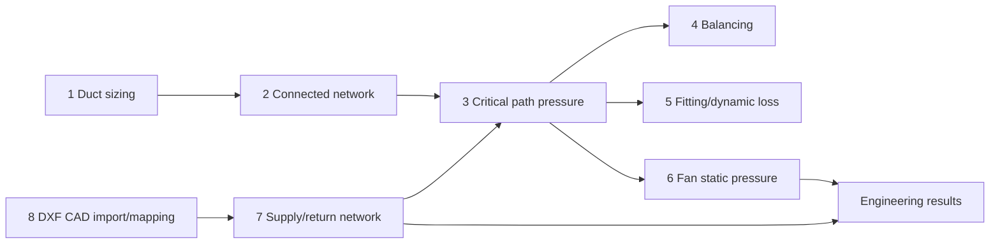

# HVAC Duct DX Engineering Architecture

This document records the verified software and engineering boundaries of the eight development phases. A phase is marked implemented only for behavior directly covered by source inspection and executed tests; an implementation is not a claim of construction or commissioning compliance.

## Phase 1 — Duct sizing engine

`duct_design/engine.py` is a pure-Python segment sizing engine. Inputs are CFM, feet, inches, temperature in °C, absolute pressure in kPa, roughness in mm, and user-selected screening limits. It uses ideal-gas density, Sutherland viscosity, the Huebscher rectangular equivalent diameter, Reynolds number, Darcy friction factor (`64/Re` for laminar and Colebrook–White for turbulent flow), and Darcy–Weisbach pressure loss. Outputs retain inches water gauge, fpm, and CFM. It is a preliminary section-sizing tool: it does not claim SMACNA construction compliance or a complete system pressure requirement.

## Phase 2 — Connected duct network

`duct_design/network/` models nodes, directed segments, terminal demands, and deterministic rooted-tree topology. Supply edges run source-to-terminal. Validation rejects duplicate IDs, unknown references, cycles, disconnected nodes, invalid roles, missing terminal demands, negative/non-finite values, and bad dimensions. Reverse topological aggregation enforces terminal-demand mass conservation and passes calculated flow to the existing sizing engine; it does not duplicate sizing equations.

## Phase 3 — Critical path pressure analysis

No critical-path subsystem is present on the Phase 7 dependency branch. Each segment retains the existing sizing result, including straight and entered aggregate-K losses, but `DuctNetworkResult.network_pressure_status` remains `NOT_CALCULATED`. A complete critical path must sum the segment losses on each physically valid terminal path and select the maximum with deterministic tie-breaking; it must not be confused with complete FESP.

## Phase 4 — Duct pressure balancing

No branch-balancing solver is present in this repository state. The network engine calculates required terminal flows but does not redistribute flow, size balancing dampers, solve resistance changes, or model field balancing. This is missing functionality, not an assertion that balancing is out of scope for an eventual product.

## Phase 5 — Fitting and dynamic loss engine

The existing sizing engine accepts a user-entered aggregate `fitting_k` and reports `K × velocity pressure` separately from straight friction. It does not select fitting coefficients from geometry, distinguish elbow/tee/wye/transition/damper references, or establish an ASHRAE/SMACNA coefficient basis. Coefficients must therefore be treated as externally supplied inputs and are not evidence of standards compliance.

## Phase 6 — Fan static pressure calculation

No verified complete FESP engine is present on this branch. Supply/return segment losses, filters, coils, equipment losses, fan inlet/outlet conditions, leakage, and static-versus-total pressure boundaries are not integrated into a fan selection result. Do not interpret a segment or critical-path loss as FESP.

## Phase 7 — Supply and return network engine

Supply behavior remains source-rooted and supports multi-level branching, terminal-demand aggregation, deterministic ordering, flow conservation, sizing integration, and explicit mismatch diagnostics. Return behavior is now explicit when `sink_node_id` is supplied (or the historical source field identifies an `END` sink): edges must point from return grilles through branches toward the equipment sink. The implementation normalizes this graph for the existing rooted-tree solver, then maps segment endpoints and terminal paths back to physical return direction. Return and supply values are independent network instances; no equality assumption is introduced. The result preserves segment losses but reports network pressure as not calculated.

A legacy source-rooted `RETURN` object remains accepted for compatibility with the Phase 2 API and existing regression fixtures. New engineering models should always use an explicit sink and physically directed edges; the compatibility form is not evidence of reverse-flow correctness.

## Phase 8 — CAD integration

`duct_design/cad/` implements a DXF-only pipeline: file extension/size validation, `ezdxf` parsing, unit normalization, stable source handles, layer/entity inspection, supported LINE/LWPOLYLINE/POLYLINE/ARC/CIRCLE/INSERT/TEXT/MTEXT extraction, unsupported-entity diagnostics, duplicate/zero-length checks, conservative layer suggestions, explicit manual layer mapping, CAD-to-network conversion, and DXF export to a separate file. Geometry is not silently converted into engineering objects: only user-confirmed duct layers and explicit terminal mappings are accepted. Segment direction is not inferred from proximity; it must be authored in the mapping (source-to-terminal for supply and grille-to-sink for return).

The `CadIntegrationPage` is registered as the `CAD Import` page in the existing `ui_shell.py` nine-page navigation. It provides import, layer listing, and validation summary using the pure-Python pipeline. The existing application legacy room-designer and schedule-export screens are preserved; no duplicate drawing editor was introduced. Native DWG parsing is not claimed. Use a reviewed DWG-to-DXF conversion workflow when needed.

## Units and validation boundaries

Network flows are CFM, segment lengths are feet, dimensions are inches, `fitting_k` is unitless, and existing pressure outputs are inches water gauge. CAD coordinates are normalized to the requested target unit; unitless drawings are left unscaled and require explicit user confirmation before engineering use. Endpoint tolerance is configurable. A visually touching entity is not treated as connected unless its endpoints fall within the configured tolerance and the mapping is validated.

## Verification

The Phase 2 network regression suite executes independently of input ordering. Phase 7 tests cover physical return direction, shared return flow, terminal roles, and conservation. Phase 8 tests create representative DXF fixtures and verify units, entity kinds, layers, geometry diagnostics, manual mapping, return-network conversion, and import/export round-trip. The full repository quality commands and their final counts are recorded in the engineering audit report generated for the implementation branch.
